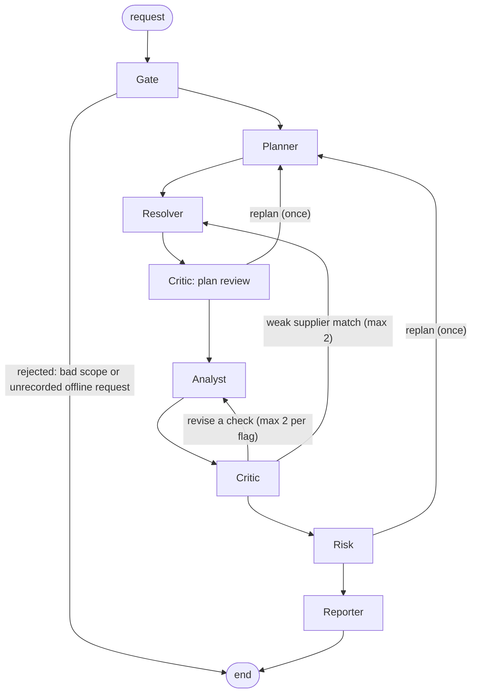

# ProcureLens

**Open Agent Hackathon 2026 · Track 02: The Agent That Can Explain Why · Team OhMyFally**

ProcureLens (the code and API call it the *Procurement Integrity Investigator*) helps an **agency internal auditor** answer one
question: *which of our procurement awards in this period need a closer look, and why?*

The problem is integrity review of Singapore public procurement. GeBIZ publishes thousands of awards, the ACRA registry holds
millions of company records, and the Auditor-General's reports describe the failure patterns, but nobody can join them by hand.
A team of agents does the joining and then **explains each result**: every item in the memo cites the Zetaris query and source rows
behind it, the red-flag rule that fired, and the AGO excerpt that says why that pattern matters.

> **Wording.** Everything ProcureLens produces is an **"anomaly for review"**. It is never a finding of fraud or wrongdoing.
> A human auditor decides. See [Responsible AI](#13-responsible-ai).

## Contents

1. [What it is](#1-what-it-is) · 2. [Quick start](#2-quick-start-for-judges) · 3. [How SAMPLE_MODE works](#3-how-sample_mode-really-works) ·
4. [Architecture](#4-architecture-and-agent-roles) · 5. [Red flags](#5-red-flags-r1-r9) · 6. [Traces and logs](#6-traces-and-logs) ·
7. [Sponsor technology](#7-sponsor-technology-explanation) · 8. [Evaluation](#8-evaluation) · 9. [Data and licences](#9-data-sources-and-licences) ·
10. [Configuration](#10-configuration) · 11. [Tests](#11-tests) · 12. [Limitations](#12-limitations) · 13. [Responsible AI](#13-responsible-ai) ·
14. [Pre-existing components](#14-pre-existing-components-to-declare) · 15. [Team](#15-team) · 16. [Repository layout](#16-repository-layout)

## 1. What it is

| | |
|---|---|
| **Users** | Internal auditors at a Singapore government agency |
| **Input** | An agency, a date range, and optionally a list of red flags (`input_examples/*.json`) |
| **Output** | A ranked review memo (JSON and Markdown), a JSONL trace of every agent step, and a run summary |
| **Data layer** | Zetaris: GeBIZ awards and rules (Postgres), the ACRA registry (Parquet on S3) and synthetic internal records, queried as one federated SQL surface |
| **Reasoning** | Nemotron models, reached only through Meterless Nightshift |
| **Memory** | Meterless H-MEM: an auditor's *Dismiss* suppresses the same finding next time |
| **Entry points** | CLI `run.py`, HTTP API `run.py --serve` (`POST /run`), optional web UI in `web/` |

## 2. Quick start for judges

### Path A: offline sample mode (no services, no credentials)

This replays live-recorded Zetaris results and Nightshift replies for the five recorded inputs. The agents, rules, Critic and
Reporter still run. Read [section 3](#3-how-sample_mode-really-works) for exactly what is and is not real.

**With Python 3.11:**

```bash
python3.11 -m venv .venv && source .venv/bin/activate
pip install -r requirements.txt
SAMPLE_MODE=true python run.py --input input_examples/example_1.json
```

Try the other recorded inputs the same way: `example_2.json`, `example_3.json`, `example_4.json`, `example_remaining.json`.

**With Docker:**

```bash
docker build -t oah-submission .
docker run --rm -p 8000:8000 -e SAMPLE_MODE=true oah-submission
```

If port 8000 is busy, use another host port, for example `-p 8101:8000`, and change the URL below to match. In a second terminal:

```bash
curl -X POST http://localhost:8000/run -H "Content-Type: application/json" -d @input_examples/example_1.json
```

You will see one line per agent step on stdout, the full trace in `logs/<run_id>.jsonl`, and the memo in `logs/<run_id>.md` and
`logs/<run_id>.memo.json`. The CLI prints the memo after the trace; the API returns it in the response. A request that has no
recorded data is refused with a message that lists what is recorded.

### Path B: full live setup

Needs Docker (Zetaris alone wants 8 GB of memory and 4 CPUs), Zetaris running locally, and Meterless Nightshift running with
an NVIDIA key in its **Providers** tab (never in this project). Follow the Participant Setup Guide for Zetaris and Nightshift,
then:

1. **Nightshift apps.** In the Nightshift Console, under *Apps*, create two apps: `procurement-integrity` bound to the **deep**
   mode and `procurement-integrity-fast` bound to the **fast** mode. Nightshift binds one mode per app, so the app name is how
   this project picks a lane.
2. **Configure.** Copy the example file and fill in the Zetaris API key, the Nightshift runtime token, a Postgres password and a
   long random `PSEUDONYM_KEY`. Set `SAMPLE_MODE=false` so a live run can never fall back to a recording.

   ```bash
   cp .env.example .env
   python3.11 -m venv .venv && source .venv/bin/activate
   pip install -r requirements.txt
   ```

3. **Containers.** Start Zetaris first (it creates the `zetaris_default` Docker network), then ours: `pi-postgres`, `pi-s3`
   (SeaweedFS) and `pi-hmem`. Building `pi-hmem` runs the official H-MEM conformance suite and fails the build if it does not pass.

   ```bash
   docker compose up -d
   python scripts/smoke_test.py      # 3 checks: Zetaris REST, Nightshift deep lane, Nightshift fast lane
   ```

4. **Load and register the data, then resolve suppliers.** Order matters: `seed.py` empties the supplier crosswalk and the
   derived R5 scores, so rerun the later steps after any reseed.

   ```bash
   python scripts/seed.py                       # Postgres tables, ACRA Parquet on S3, fictional planted cases
   python scripts/register_zetaris.py           # registers the sources and the procurement_usl model in Zetaris
   python -m app.resolver.run --pass 1          # Resolver pass 1: exact and former-name matches
   python -m app.resolver.run --pass 2          # Resolver pass 2: fuzzy, fast-lane LLM tie-break, unresolved
   python scripts/prepare_r5.py --download-model   # once: R5 text-similarity scores (see below)
   ```

   Nightshift does not serve `/embeddings` (it returned HTTP 501 when we checked on 23 Oct; the script also handles 404 and 405), so R5 uses a small
   local model, `sentence-transformers/all-MiniLM-L6-v2` through fastembed. `--download-model` fetches it once into the
   gitignored `.cache/embeddings/`. Investigation runs never download or load a model; they read the precomputed scores from
   Zetaris.

5. **Run.**

   ```bash
   python run.py --input input_examples/example_1.json     # one run from the command line
   # or serve the API:
   python run.py --serve                                    # 0.0.0.0:$PORT, default 8000
   curl -X POST http://localhost:8000/run -H "Content-Type: application/json" -d @input_examples/example_1.json
   ```

   `POST /run` waits and returns the finished run. Add `?wait=false` to get `202` and a `run_id` at once, then poll
   `GET /runs/{run_id}` or stream `GET /runs/{run_id}/events` (server-sent events). Live runs of the three examples took about
   4 minutes, 1 minute and 5 minutes; a run is capped at 40 model calls (`LLM_CALL_CAP`).

**Running the API in Docker against live services.** Inside a container `localhost` is the container itself, so point the
app at the host with the `host.docker.internal` URLs that are commented in `.env.example`:

```text
ZETARIS_REST_URL=http://host.docker.internal:8888/api/v1.0
METERLESS_BASE_URL=http://host.docker.internal:8088/v1
HMEM_URL=http://host.docker.internal:7070
```

Mounting `.env` lets the app read it with `python-dotenv` exactly as on the host; `--env-file .env` also works, as long as
comments stay on their own lines (Docker keeps an inline `# ...` as part of the value). On Linux, add `--add-host=host.docker.internal:host-gateway`. Mount `logs/` to keep the traces.

```bash
docker run --rm -p 8000:8000 -v "$PWD/.env:/app/.env:ro" -v "$PWD/logs:/app/logs" oah-submission
```

(`S3_ENDPOINT=http://pi-s3:8333` stays as is: it is the address Zetaris uses to reach our S3 container, not one the app uses.)

### Web UI (optional)

`web/` is a Next.js 15 interface on **port 3100** (Zetaris owns 3000). It is not needed for the judge paths above and is left out
of the Docker image. Start the API first, then:

```bash
cd web
cp .env.example .env.local     # optional; the defaults point at the API on 127.0.0.1:8000
npm install
npm run dev                    # http://127.0.0.1:3100
```

It shows a live agent timeline (the SSE stream), the ranked memo, an evidence drawer with the SQL and rows, and a human-review
queue with **Confirm** and **Dismiss**. A decision is forwarded by the Next.js route `web/app/api/auditor-decision/route.ts` to
H-MEM (`HMEM_URL`), so Confirm and Dismiss need the `pi-hmem` service. A *Replay mock run* button plays `web/mocks/run_demo.json`
(fictional suppliers) without any backend. Details: [web/README.md](web/README.md).

## 3. How SAMPLE_MODE really works

`SAMPLE_MODE` is read in [app/adapters/config.py](app/adapters/config.py) and acted on in [app/replay.py](app/replay.py) and the
two adapters. The default is **true** when the variable is unset.

| Situation | What happens |
|---|---|
| `SAMPLE_MODE=true`, **no** Zetaris key **and** no Nightshift token (unset, empty or an `.env.example` placeholder such as `your-...`) | **Offline.** No socket is opened. Every Zetaris query and model call is answered from `data/replay/<set>/`. H-MEM is skipped (trace line `memory_skipped`). |
| `SAMPLE_MODE=true` and **at least one** real credential | **Live first.** Services are called normally. A recording answers only after an *outage-type* failure: Zetaris connection error, timeout or HTTP 5xx after retries; Nightshift connection error, timeout, or HTTP 408, 425, 429, 499 or 5xx after retries. A 4xx, a bad-JSON reply or the call cap is never replayed. After the first outage a 30-second breaker serves recordings directly. |
| `SAMPLE_MODE=false` | Never replays. A failed service is a failed step. |

So a real `.env` with credentials does **not** put you offline even with `SAMPLE_MODE=true`. We checked this by pointing both
URLs at a closed port with dummy credentials: the run tried the live services first (about 17 seconds of retries), then finished
from the recordings and labelled them.

**What is replayed.** Five recorded sets under `data/replay/`, one per file in `input_examples/`, captured from real runs on 23-24 Oct:
`hdb-fy2425` (example 1), `pa-2024` (example 2), `nparks-2023-2025` (example 3), `pa-fy2125` (example 4) and `synthetic-2025` (`example_remaining`). Each holds
the Zetaris result for every SQL statement (keyed by a hash of the statement) and every Nightshift reply, with the original
receipt id and routed model.

**What is real in an offline run.** The Gate, Planner, Resolver, Analyst, Critic, Risk and Reporter code, the red-flag logic over the
returned rows, the Critic's checks, the wording gate and the memo rendering all execute. What is not live is the *source data and
model text*: they come from the recording.

**Labels, so a recording is never mistaken for a live answer.**

- Ids carry a `replay:` prefix (`replay:<hash>` for Zetaris, `replay:rcpt_req_...` for Nightshift), the model name ends in
  `(replayed)`, and trace events carry `"replayed": true` with `[replayed from recorded run]` in the summary.
- The memo gets a limitation line: *"Replayed from a recorded run: services were offline. N Zetaris result(s) and M Nightshift
  reply(ies) came from the recorded set '...', not from live services."* The same counts are in `stats.replayed`.
- A model call with no recorded reply fails like an outage, so that agent uses its **rule-based fallback** (deterministic scores,
  template narrative, no model claim check), and the memo says how many calls did.

**What is refused, not faked.** Offline, a request whose agency and period do not match a recorded set is rejected at the Gate
(CLI exit code 2; API `422 request_rejected`) with the list of what is recorded. The match is on **agency and period only**: if
you keep the agency and period but ask for different flags (for example `--flags R2` on the People's Association set), any query
that was not recorded is reported as a failed check in the trace and memo; nothing is invented. Offline runs do not call H-MEM,
so they never show memory suppression; the live examples in `output_examples/` do.

`output_examples/` holds saved outputs of **live** runs (Zetaris, Nightshift and H-MEM up). They are examples to read, and the
code never returns them.

## 4. Architecture and agent roles



The edges come from [app/orchestration/graph.py](app/orchestration/graph.py) (LangGraph).

| Agent | Lane | What it does |
|---|---|---|
| **Gate** | none | Rejects an empty agency, reversed dates, a period over six years, or an unknown flag id. |
| **Planner** | deep | Chooses which checks to run, limited to checks that have SQL. Flags the auditor asked for always run. Reads a catalog from Zetaris and recalls past auditor decisions from H-MEM. Falls back to a deterministic plan if the model fails. |
| **Resolver** | fast (tie-break only) | Reads the supplier crosswalk (GeBIZ names to ACRA UENs) from Zetaris and resolves any names without a match. On a Critic retry it widens the strategy: exact and former-name, then fuzzy, then an LLM tie-break. |
| **Analyst** | none | Runs one federated SQL file per red flag through Zetaris and turns each row into a finding with its evidence (query id, SQL, rows). |
| **Critic** | fast | Verifies before anything reaches the memo, in this order: (1) re-runs each check's SQL through Zetaris and confirms the cited row still exists; (2) rejects Resolver matches below 0.92 confidence; (3) recalls H-MEM; (4) R3 address-density review; (5) one batched model call per five findings asking whether each summary is supported by its rows. It also runs the plan review. |
| **Risk** | deep | Applies the wording gate, escalates findings to a human, scores priority 0-100 (a deterministic score blended 60/40 with the model's score, in batches of seven), and may request a replan. |
| **Reporter** | deep | Groups R3 awards by shared address, attaches up to two AGO citations per flag, rewrites any banned wording, writes the narrative opening, and renders the memo. |

**The loops, all bounded** (`MAX_RETRIES=2`, one replan, `LLM_CALL_CAP=40`):

- **Critic to Analyst:** if a cited row is not reproduced, or a summary is not supported, the check is re-run. After two retries
  per flag the finding is given up on: rejected if the evidence cannot be reproduced, escalated to a human if only the wording is disputed.
- **Critic to Resolver:** a supplier match under 0.92 goes back to the Resolver with a wider strategy, at most twice, then the finding is rejected.
- **Plan review, one replan:** the Critic compares the plan with what the data can support. A missing must-have check (or R8 when
  five or more supplier names are unresolved) sends the run back to the Planner once. Data limits that cannot be fixed are recorded as
  memo limitations instead. The Risk agent can also request the single replan (for example after a check failed); the plan review and
  Risk share one replan budget.
- **R3 address-density escalation:** for each group of winning suppliers sharing an ACRA address, the Critic asks Zetaris how many
  ACRA entities are registered there. A busy block (25 or more entities) lowers confidence to at most 0.72, because it is probably a
  shared building. A quiet address, or one with a missing level or unit, is **escalated to a human**.
- **H-MEM suppression:** an exact earlier *Dismiss* by an auditor (same UEN, same flag, same agency) marks the finding
  `suppressed` and cites the memory. A dismissed *pattern* at the same agency lowers confidence by 30%. Memories do not cross
  agencies unless a decision was saved with global scope.

## 5. Red flags R1-R9

From [data/rules/red_flags.yaml](data/rules/red_flags.yaml). Each flag with SQL is one file in [sql/checks/](sql/checks/); the
parameters are also loaded into the Zetaris-visible `rules` table.

| ID | Priority | Logic | Limitation (as written in the rules file) |
|---|---|---|---|
| **R1** | must | Supplier incorporated less than 183 days before the award | Needs a Resolver match (GeBIZ has no UEN). Newly formed entities are legitimate for many reasons. |
| **R2** | must | ACRA status is struck off, ceased, in liquidation or similar | ACRA publishes the current status only, so the entity may have been live when it won. |
| **R3** | must | Two or more winning suppliers at one agency share an exact ACRA address | Shared business centres and virtual offices produce benign matches. The Critic's density check reduces this. |
| **R4** | must | Same agency and supplier: two or more awards under S$90,000 within 90 days that sum to over S$90,000 | **Partial.** GeBIZ here holds tender (ETT) awards only and **no quotation (ETQ) records** (0 of 18,464 rows), so splitting inside the quotation band cannot be seen. Framework call-offs can look like splitting. |
| **R5** | should | Embedding similarity between the supplier's SSIC description and the tender description is below 0.2 | Uncalibrated; always escalated with confidence at most 0.6. Needs the one-time local model preparation. |
| **R6** | should | One supplier holds 50% or more of an agency's award value in a tender category (at least five tenders) | Ten keyword categories, approximate. Specialised categories legitimately have few suppliers. |
| **R7** | stretch | Supplier has former names (informational) | **Not implemented**: it is defined in the rules file but has no SQL in `sql/checks/`. |
| **R8** | must | Local-looking name (PTE LTD, PRIVATE LIMITED, LLP) with no ACRA match above threshold | Our ACRA subset is a candidate set; typos and renames can fail to match. A lead for manual lookup. |
| **R9** | should | Awarded supplier is not rank 1 in the published evaluation scores | **Synthetic internal records only**; no real evaluation data is used. Ties are not flagged. |

Details and boundary cases: [docs/handover/d2-red-flags.md](docs/handover/d2-red-flags.md) and [docs/handover/d1-data.md](docs/handover/d1-data.md).

## 6. Traces and logs

Every run writes `logs/<run_id>.jsonl` (one JSON object per line), prints the same steps to stdout, and writes the memo beside it.
Secret-shaped strings are redacted before anything is written.

**Trace fields** ([app/schemas.py](app/schemas.py), `TraceEvent`):

| Field | Meaning |
|---|---|
| `timestamp`, `trace_id` | UTC time; the run id |
| `agent_name`, `action`, `target_agent` | Who acted, what it did, and who it handed to |
| `input_summary`, `output_summary` | Short text of the step |
| `status` | `success`, `needs_revision`, `retrying`, `escalated`, `partial_success` or `failed` |
| `retry_count`, `confidence` | Loop count and the step's confidence, when it has one |
| `zetaris_query_ids` | Every Zetaris query behind the step |
| `meterless_receipt_id(s)`, `routed_model`, `latency_ms`, `egress` | The Nightshift receipt, the model that actually answered, and where the request went |
| `memory_hits`, `memory_ids` | H-MEM memories used by the Planner and Critic |
| `replayed` | `true` when the step was served from a recording |

**Stdout** is one line per event: time, agent, action, status, `-> target`, `model=...`, `zetaris=Nq[id]`, `receipts=N[id]`,
`retry=N`, then the start of the output summary.

**Run summary.** `GET /runs/{run_id}/summary` returns how the agents worked, computed from the trace: critiques, retries,
escalations, replans, partial successes, model calls, prompt and completion tokens, duration, per-agent time, memory hits, findings
cleared by memory, Zetaris query count, the loops (from, to, reason) and plan notes. It also works for a run that is no longer in
memory, by reading `logs/<run_id>.jsonl`.

**Real examples.** `output_examples/example_{1,2,3}.trace.jsonl` are traces of live runs, with their memos beside them. These two
lines are copied unedited from `example_1.trace.jsonl`. The first is the Planner's model call: a Zetaris query id, the Nemotron
model that answered, and the Nightshift receipt. The second is the Critic escalating an R3 shared-address group to a human.

```jsonl
{"timestamp":"2026-10-23T10:58:56.387Z","trace_id":"run_20261023_185852_8201f9","agent_name":"PlannerAgent","action":"plan","input_summary":"agency=Housing and Development Board 2024-04-01..2025-03-31 flags=auto","output_summary":"checks=['R1', 'R2', 'R3', 'R4', 'R5', 'R6', 'R8', 'R9'] No specific flags were requested, so all implemented checks are defaulted for HDB's FY2024/25 review period; each screens for distinct procurement-integrity anomalies warranting further review. [used 0 past decisions from memory]","target_agent":"ResolverAgent","retry_count":0,"status":"success","zetaris_query_ids":["1ec28404-3b3d-42be-8af8-f754d0f2677f"],"meterless_receipt_id":"rcpt_req_lrl4390d","meterless_receipt_ids":["rcpt_req_lrl4390d"],"routed_model":"nvidia/nemotron-3.5-super-vl-120b-a12b","latency_ms":2765,"egress":{"destination":"nvidia","coverage":"pattern_floor","prompt_chars":901,"redacted":0,"withheld":0},"memory_hits":0,"memory_ids":[]}
{"timestamp":"2026-10-23T10:59:40.970Z","trace_id":"run_20261023_185852_8201f9","agent_name":"CriticAgent","action":"address_density","input_summary":"1 GATEWAY DRIVE #25-01 S608531 (2 suppliers, 3 awards)","output_summary":"escalate: only 3 entities at this address, so the shared unit is ambiguous","target_agent":"RiskAgent","confidence":1.0,"retry_count":0,"status":"escalated","zetaris_query_ids":["1cf24390-83a4-440b-8be3-3989cc8f4eee"],"meterless_receipt_ids":[]}
```

In the same file the Critic's `validate_claims` line reads "used 4 past decisions (recalled 11)" and the memo's `stats` record 6
suppressed findings: those are H-MEM suppressions. Examples 1 to 3 contain no Critic-to-Analyst retry or replan
(`revise=[]` in all three). `example_4` (People's Association, 2021-04-01 to 2026-03-31, live run `run_20261024_085112_e8457f`, no replayed data) is the one that shows
the loops: its Critic `validate_claims` step returns `needs_revision` 3 times, the Analyst and Resolver re-run with
`retry_count` up to 2, and the Critic escalates 26 shared addresses to human review. The loops are also exercised by
`tests/test_graph.py` and `tests/test_behaviour.py`, and the web mock run plays one.

## 7. Sponsor technology explanation

### Zetaris: the data layer

All data access goes through Zetaris ([app/adapters/zetaris.py](app/adapters/zetaris.py), `POST /sql-editor/sqls/run`). The only
direct database access is in the setup scripts that load the data.

- **Federated SQL over two kinds of store.** Zetaris sees `gebiz_pg` (Postgres: `awards`, `rules`, `ago_chunks`, `supplier_xwalk`),
  `internal_pg` (synthetic bids, evaluations and conflict-of-interest declarations) and `ACRA_FILES.entities` (the ACRA registry as
  Parquet on S3). A check such as R1 is a single statement that joins Postgres awards, the crosswalk and the S3 Parquet registry
  ([sql/checks/R1.sql](sql/checks/R1.sql)); registration lives in [sql/register/](sql/register/) and `scripts/register_zetaris.py`.
- **USL model `procurement_usl`.** A Unified Semantic Layer model in the namespace `lightning.metastore.procurement` links
  `award` to `supplier_xwalk` to `supplier_registry` with foreign keys, plus a flat `award_profile` table. Be precise about its role:
  it is registered and verified by `register_zetaris.py` and demonstrated in [scripts/usl_demo.sql](scripts/usl_demo.sql); the
  agents' red-flag SQL queries the registered sources directly.
- **The Critic re-queries Zetaris to verify its own claims.** For each flag it re-runs the check SQL and confirms the cited row is
  reproduced, then appends a fresh evidence entry with the new query id. A second Zetaris query measures R3 address density.
- **Pushdown saves tokens.** Joins and filters run in Zetaris, so the model sees only flagged rows. From
  [output_examples/token_savings.json](output_examples/token_savings.json) (HDB FY2024/25, recorded live run):

  | | Rows | Characters | Estimated tokens |
  |---|---|---|---|
  | Pushdown: what the 8 model calls actually received | flagged rows only | 47,909 | 11,977 |
  | Naive: dump the joined awards x crosswalk x ACRA rows once | 278 rows, 36 columns | 145,115 | 36,279 |

  That is about **3.0x fewer tokens (67%)**. Tokens are estimated as characters / 4, not counted by a tokenizer; the provider
  reported 27,837 prompt tokens for the pushdown calls, so the ratio rests on the estimate for both sides. The naive figure is a
  lower bound (one dump, no instructions). The sample is a few hundred joined rows, so the gap would widen on the full registry.
  See the caveats in the file.
- **Masking.** The local Zetaris (2.4.x) has only table and namespace grants, no column masking, so the public view is
  implemented in the API ([Privacy](#9-data-sources-and-licences)).

### Meterless H-MEM: auditor memory

The Meterless engine we implemented is **H-MEM**. It is a TypeScript service in [services/hmem/](services/hmem/), adapted from the
Meterless reference implementation (`engines/hmem/reference` in github.com/Meterless/Meterless), which is licensed Apache-2.0. The
`LICENSE` is kept and [services/hmem/NOTICE](services/hmem/NOTICE) lists our changes: file-backed persistence so memory survives a
restart, an HTTP server (`src/server.ts`) with `/healthz`, `/add`, `/query`, `/feedback`, `/auditor-decision` and `/ledger`, a
Dockerfile, and HTTP tests. `src/index.ts` still exports `HMEM`, so the official suite runs against it unchanged.

**The feature it powers.** An auditor presses *Confirm* or *Dismiss* on a finding. The decision is stored in H-MEM as a long-term
memory tagged with the agency, UEN and flag. On the next run:

- the **Critic** recalls memories for each accepted finding and **suppresses** one that the auditor already dismissed (exact
  agency, UEN and flag), citing the memory id in the finding, or lowers the confidence of a dismissed pattern;
- the **Planner** recalls memories for the agency and records how many it used.

H-MEM keeps an append-only trust ledger (`GET /ledger`, mirrored to `logs/hmem-ledger.jsonl`). The HTTP contract is in
[docs/agents/CONTRACTS.md](docs/agents/CONTRACTS.md) section 6.

**The test.** Run the official conformance suite against our implementation:

```bash
cd services/hmem && npm install
HMEM_IMPL="$(pwd)/src/index.ts" npx tsx ../hmem-upstream/conformance/runner.ts
```

Result on 23 Oct: **13/13 checks passed** (saved in [logs/evidence/hmem-conformance-d1-final.txt](logs/evidence/hmem-conformance-d1-final.txt);
the run on the unmodified reference is in `hmem-conformance-d1.txt`). The same suite runs when the `pi-hmem` image is built, and
`GET /healthz` reports `conformance: pass` only if it did. `npm test` in `services/hmem` runs 21 more tests (10 unit, 11 HTTP), all passing.

If H-MEM is down, runs continue without memory and the trace says so (`memory_skipped`). It is never fatal.

### Meterless Nightshift: the AI provider

Every model call goes through Nightshift's OpenAI-compatible `POST /v1/chat/completions`
([app/adapters/nightshift.py](app/adapters/nightshift.py)). There is no direct provider call and no NVIDIA key in this project.

| | Deep lane | Fast lane |
|---|---|---|
| Nightshift app (header `meterless-app`) | `procurement-integrity` | `procurement-integrity-fast` |
| Model name sent | `meterless/deep` | `meterless/fast` |
| Used by | Planner, Risk, Reporter | Critic claim check, Resolver tie-break |

Each request sends `Authorization: Bearer <runtime token>`, `meterless-app` and `meterless-scope: user`. Every response carries a
`meterless` receipt; the tracer keeps the receipt id, the `routed_model`, the latency and a trimmed egress record
(`destination`, `coverage`, sizes) on the trace line. Replies are validated against a JSON schema with one repair retry, and
timeouts, 429, 499 and 5xx are retried a bounded number of times. A failed call degrades that agent to its rule-based fallback.

### NVIDIA: Nemotron through Nightshift

In the four saved live traces, every model call was routed to **`nvidia/nemotron-3.5-super-vl-120b-a12b`**, on both lanes:
the Planner (deep), Critic claim check (fast), Risk scoring (deep) and Reporter narrative (deep). The `routed_model` field on each
trace line is the evidence. The Resolver's fast-lane tie-break is not in those traces because it runs in the setup passes; the
handover note [docs/handover/d1-data.md](docs/handover/d1-data.md) (section 8) records one, receipt `rcpt_req_6u2qusst`, routed to
`nvidia/nemotron-3.5-lightning-30b-a3b`; in our 24 Oct clean-setup test the same tie-break was routed to
`nvidia/nemotron-3.5-super-vl-120b-a12b`, so Nightshift decides the model per call. `meterless/auto` can route to a non-NVIDIA model, which is why we log the routed model on every call.

### What was unique about our use

- **Zetaris is the evidence trail, not just a database.** Every finding carries the query id, SQL and rows. The Critic re-queries
  Zetaris to reproduce the finding before it can reach the memo, and checks R3 against registry density.
- **Memory changes what the agent reports.** H-MEM is not a chat history. A recorded auditor decision removes a repeat finding
  from the next memo and the trace and memo cite the memory id.
- **One model, two lanes, visible routing.** The deep and fast lanes are separate Nightshift apps; every call's receipt and
  routed Nemotron model is on the trace.
- **Honest offline mode.** Recorded Zetaris and Nightshift answers are replayed through the same adapters and agents, labelled everywhere.

### Cursor

Not used, so we are not competing for the Cursor award. The rules allow any coding tool; we used AI coding assistants, and
`CLAUDE.md` and `AGENTS.md` are the instructions we gave them.

## 8. Evaluation

Scripts by Inchara: [scripts/eval.py](scripts/eval.py) (combined harness) and [scripts/eval_resolver.py](scripts/eval_resolver.py)
(Resolver only). Both need live Zetaris; they disable replay. Method and reproduction: [docs/handover/d2-evaluation.md](docs/handover/d2-evaluation.md)
and [data/eval/README.md](data/eval/README.md). The numbers below are quoted from
[output_examples/metrics.json](output_examples/metrics.json) and [output_examples/resolver_metrics.json](output_examples/resolver_metrics.json).

| Measure | Result in the file | Scope |
|---|---|---|
| Planted cases caught | 8 of 8 cases; 15 of 15 expected awards; negative controls passed | SQL candidate findings, **before** the Critic, Risk or memory. Fictional cases only. |
| Resolver accuracy | 100 of 100 labelled names correct (99 links, 1 correct abstention) | In-sample, agent-reviewed labels. Human-reviewed accuracy: 0 labels, so not measured. |
| Resolver links passing the Critic threshold (0.92) | 94 of 99 | Same set |
| Precision on real awards | **null: not measured.** 30 findings queued for human review, 0 reviewed | |
| LLM calls in the eval | 0 (SQL checks only) | So it says nothing about a full investigation's model use |

These are check-level, in-sample results. They do not measure final-memo accuracy or precision on real awards, and the files say so
under `limitations`. One more caveat: `metrics.json` was generated from an earlier version of `input_examples/` (its three sample
rows are HDB calendar 2025, People's Association 2024 and NParks 2023-2025; the hashes in its `provenance` block no longer match the current example files).
The planted-case and Resolver numbers do not depend on those inputs. `metrics.json` also contains the machine paths of the laptop it was generated on.

Other saved outputs: [output_examples/remaining_flags_verification.json](output_examples/remaining_flags_verification.json) and
[remaining_flags_memo.md](output_examples/remaining_flags_memo.md) (R5, R6, R9 on the synthetic agency),
[token_savings.md](output_examples/token_savings.md).

## 9. Data sources and licences

| Source | What we used | Licence |
|---|---|---|
| **GeBIZ awards** (data.gov.sg dataset `d_acde1106003906a75c3fa052592f2fcb`) | 18,464 rows, Apr 2021 to Mar 2026. Tender (ETT) awards only, no UEN. The committed sample is 2,465 awards for HDB, People's Association and National Parks Board. | Singapore Open Data Licence v1.0 |
| **ACRA Information on Corporate Entities** (data.gov.sg collection 2) | 2,124,508 rows downloaded; a candidate set of 23,067 matched by name is kept locally and **not committed**. The committed sample is 1,226 entities. | Singapore Open Data Licence v1.0 |
| **Auditor-General's Office annual reports** | Eleven verbatim excerpts (FY2021/22 to FY2024/25) in [data/ago/](data/ago/), each with its source page link | Quoted with attribution; see [data/ago/README.md](data/ago/README.md) |
| **Planted cases and synthetic internal records** | Written by us: fictional suppliers (UENs `T99ZZ...`, postcodes `9990xx`, `TEST` in every name) | Ours; agents never read `data/eval/planted.json` |

Contains information from GeBIZ and the ACRA register, accessed via data.gov.sg under the Singapore Open Data Licence v1.0.
Counts, regeneration commands and the full list of data weaknesses are in [data/README.md](data/README.md) and
[docs/handover/d1-data.md](docs/handover/d1-data.md).

**Privacy.** The repository is public, so the committed ACRA sample is minimised: it keeps only entities the Resolver matched to a
GeBIZ supplier (plus a few candidates for ambiguous names), and blanks `level_no` and `unit_no` for sole proprietorships and
partnerships (85 of the 1,226 rows are of that type). No real person gets a score or a flag by name that GeBIZ does not already publish.
The API has a **public view**: `GET /runs/{run_id}?view=public` and `GET /runs/{run_id}/summary?view=public` replace every supplier name with a
stable alias such as `Supplier-7F3A` (HMAC-SHA256 with `PSEUDONYM_KEY`; fictional `TEST` suppliers stay readable). It fails closed with
`503` if the key is not set. The default view is the auditor's full view. The web UI does not use the public view.

## 10. Configuration

From [.env.example](.env.example). Secrets live only in `.env`, which is gitignored.

| Variable | Default / example | Purpose |
|---|---|---|
| `ZETARIS_REST_URL` | `http://localhost:8888/api/v1.0` | Zetaris REST (use `host.docker.internal` inside Docker) |
| `ZETARIS_ORG_ID` | `1` | Sent as `X-Org-ID` |
| `ZETARIS_API_KEY` | placeholder | Zetaris bearer key |
| `METERLESS_BASE_URL` | `http://127.0.0.1:8088/v1` | Nightshift runtime |
| `METERLESS_RUNTIME_TOKEN` | placeholder | Nightshift bearer token |
| `METERLESS_MODEL_DEEP` / `METERLESS_MODEL_FAST` | `meterless/deep` / `meterless/fast` | Model names sent per lane |
| `METERLESS_APP_DEEP` / `METERLESS_APP_FAST` | `procurement-integrity` / `procurement-integrity-fast` | Nightshift apps bound to each lane |
| `POSTGRES_USER` / `POSTGRES_PASSWORD` | `pi` / `change-me` | Our Postgres container |
| `S3_ENDPOINT`, `S3_BUCKET` | `http://pi-s3:8333`, `pi-acra` | Our S3 container, as Zetaris sees it |
| `HMEM_URL` | `http://127.0.0.1:7070` | H-MEM service |
| `PSEUDONYM_KEY` | placeholder | HMAC key for `?view=public` aliases |
| `PORT` | `8000` | API port for `run.py --serve` |
| `LOG_LEVEL` | `info` | API log level |
| `SAMPLE_MODE` | `true` (also when unset) | See [section 3](#3-how-sample_mode-really-works) |
| `REPLAY_SET` | `hdb-fy2425` | Recorded set used when no set matches the request (live-first fallback only) |
| `MAX_RETRIES` | `2` | Per-loop retry limit (capped at 2 in code) |
| `LLM_CALL_CAP` | `40` | Model calls per run |
| `SOURCE_TIMEOUT_SECONDS` | `20` | Zetaris timeout (checks use at least 60) |

`S3_ACCESS_KEY` and `S3_SECRET_KEY` are optional overrides read by `register_zetaris.py` (defaults are local-only SeaweedFS values).

## 11. Tests

```bash
pytest -m "not live"
```

Current result: **127 passed, 22 skipped** in about 5 seconds, with no services running. The 22 skips are the live tests, which skip
themselves when their service is missing: `tests/test_planted_checks.py` (needs Zetaris), `tests/test_check_sql_edges.py` (needs
Zetaris and `RUN_LIVE_SQL_TESTS=1`) and `tests/test_hmem_client.py` (needs the `pi-hmem` service). The `live` marker is not
registered, so this command selects every test; the live ones simply skip. With Zetaris and H-MEM up they run, including the
planted-case checks against real data. Web tests: `cd web && npm test`.

**CI.** `.github/workflows/ci.yml` runs a TruffleHog secret scan over the full git history and `pytest -m "not live"`; on every push to `main` and every pull request.

**H-MEM conformance and tests:** see [section 7](#meterless-h-mem-auditor-memory) (13/13 conformance checks; `npm test` 21 passed).

## 12. Limitations

- **R4 is partial.** GeBIZ here has no quotation (ETQ) records, so splitting under the quotation band is invisible. R7 is not implemented.
- **The Resolver is only as good as its test.** The 100/100 score is on a selected, agent-reviewed, in-sample label set with no human
  review; fuzzy and LLM-tie-break accuracy are not established (the labelled set has none of those methods). Only 2 live tie-breaks have happened.
  Names with no local legal suffix that are absent from our ACRA subset become "out of scope", not R8. The ACRA data is a name-matched
  subset, so a renamed company whose old and new names share no first word can be missed.
- **Noisy flags.** R3 produces many benign matches (shared buildings and business centres), R2 uses current status only, and R5 and R6 are uncalibrated.
  The Critic and Risk agents reduce but do not remove this. Precision on real awards is unmeasured.
- **Offline mode covers only the five recorded inputs**, and a missing recording degrades to rule-based text.
- **Nightshift 499 and 502 errors happen.** The agent retries, then falls back to rule-based text. The committed
  `output_examples/example_3` memo shows it: its Reporter narrative failed with HTTP 499, so the memo says "narrative unavailable"
  and lists findings straight from the SQL evidence.
- **R5 needs the local model**, prepared once with `prepare_r5.py --download-model`, because Nightshift has no embeddings endpoint.
- **Live runs are slow**: about 1 to 5 minutes for the examples.
- **Not production-ready.** It is a hackathon prototype: no authentication on the API, an in-process run registry (finished runs are re-read from `logs/` after a restart), a local single-node setup.
- **Human review is required.** Every output is a lead for an auditor to check, not a conclusion.

## 13. Responsible AI

- **Wording is enforced in code, not just in prompts.** [data/rules/wording.yaml](data/rules/wording.yaml) bans terms such as
  fraud, corrupt, illegal, criminal, guilty, scam, bribe, collusion and kickback. The Risk agent checks every finding; the Reporter
  rewrites any hit with a neutral replacement; the prompts require "anomaly for review" and "may indicate".
- **Escalation to a human.** Findings are escalated rather than accepted when: confidence is below 0.7; the flag is a should-have
  rather than a must-have (R5 is capped at 0.6 and always escalated); a shared address is quiet or has a missing unit; or the Critic
  cannot verify a summary after its retries. The memo lists escalated items, and the web UI has a review queue with Confirm and Dismiss.
- **Every claim has evidence.** Each finding cites a Zetaris query id, the SQL and the rows, plus AGO context. The Critic must reproduce it first.
- **Disclaimer on every memo:** *"Automated screening output. Each item is an anomaly for review that may indicate a procurement-integrity
  concern, and requires auditor judgement. It is not a finding of wrongdoing."*
- **Limitations travel with the result.** Each memo lists the limitation of every flag that ran, plus replay and fallback notes.
- **Privacy.** Minimised public sample, no real personal data in the planted cases, a pseudonymised public view, and no personal data in logs by design.

## 14. Pre-existing components to declare

| Component | Origin | Licence |
|---|---|---|
| H-MEM reference implementation (`services/hmem-upstream/`; our service in `services/hmem/` is adapted from it) | Meterless, github.com/Meterless/Meterless | Apache-2.0 |
| Open-source libraries: LangGraph, FastAPI, uvicorn, httpx, pydantic, rapidfuzz, fastembed, pandas, pyarrow, psycopg, boto3 (see [requirements.txt](requirements.txt)); Hono and tsx (H-MEM service); Next.js and Radix UI (web) | Public packages | Their own licences |
| Public datasets: GeBIZ, ACRA, AGO reports | data.gov.sg; ago.gov.sg | See [section 9](#9-data-sources-and-licences) |
| Container images: Postgres 16, SeaweedFS 3.80, Node 22, Python 3.11 | Docker Hub | Their own licences |

**Our work began on 22 October 2026 (the first product-code commit is 22 Oct, 10:16 SGT; the window opened at 08:00 SGT).**
The eight commits dated 21 Oct (`git log`) contain only `.gitignore`, `.gitattributes`, the agent instruction files `AGENTS.md` and
`CLAUDE.md`, and planning documents under `docs/agents/`. No product code and no data were committed before the window.
Repository licence: there is no top-level `LICENSE` file yet; `services/hmem/` and `services/hmem-upstream/` carry the Apache-2.0 licence.

## 15. Team

**OhMyFally**

- **Joon Hao** (lead): orchestration and agents, adapters, tracing, API, web UI, the H-MEM service, rules and wording, AGO excerpts, replay mode.
- **Inchara**: data pipeline, entity Resolver, red-flag SQL, evaluation.

## 16. Repository layout

```text
run.py                  CLI and API entry point (run.py --input FILE | run.py --serve)
app/                    Python 3.11 package
  agents/               planner, resolver, analyst, critic, risk, reporter, ago
  orchestration/        graph.py (LangGraph wiring), state.py, factory.py
  adapters/             zetaris.py, nightshift.py, hmem_client.py, config.py
  resolver/             supplier-name matching (exact, former name, fuzzy, LLM tie-break)
  checks/               loads sql/checks/*.sql and builds findings
  api.py replay.py privacy.py run_summary.py schemas.py tracing.py
services/hmem/          H-MEM service (TypeScript, Apache-2.0), with NOTICE
services/hmem-upstream/ Meterless reference and the official conformance suite
sql/                    register/ (Zetaris sources and USL), checks/ (R1-R6, R8, R9), critic/
data/                   sample/ (committed samples), replay/ (5 recorded sets), rules/, ago/, eval/
scripts/                seed, register_zetaris, prepare_r5, smoke_test, eval, eval_resolver, record_replay, token_baseline
web/                    Next.js UI on port 3100 (optional)
input_examples/         request files (example_1 to example_4, example_remaining)
output_examples/        memos, traces and metrics from live runs
logs/evidence/          H-MEM conformance output
tests/                  pytest suite
docs/                   agents/ (contracts), handover/ (data, red flags, evaluation), drafts/run-it.md
Dockerfile docker-compose.yml .env.example metadata.json
```
