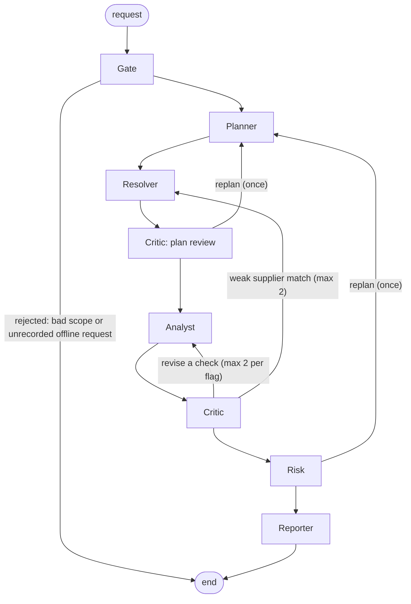

# Architecture, agent roles and traces

Part of the [ProcureLens README](../README.md).



The edges come from [app/orchestration/graph.py](../app/orchestration/graph.py) (LangGraph).

| Agent | Lane | What it does |
|---|---|---|
| **Gate** | none | Rejects an empty agency, reversed dates, a period over six years, or an unknown flag id. |
| **Planner** | deep | Chooses which checks to run, limited to checks that have SQL. Flags the auditor asked for always run. Reads a catalog from Zetaris and recalls past auditor decisions from H-MEM. Falls back to a deterministic plan if the model fails. |
| **Resolver** | fast (tie-break only) | Reads the supplier crosswalk (GeBIZ names to ACRA UENs) from Zetaris and resolves any names without a match. On a Critic retry it widens the strategy: exact and former-name, then fuzzy, then an LLM tie-break. |
| **Analyst** | none | Runs one federated SQL file per red flag through Zetaris and turns each row into a finding with its evidence (query id, SQL, rows). |
| **Critic** | fast | Verifies before anything reaches the memo, in this order: (1) re-runs each check's SQL through Zetaris and confirms the cited row still exists; (2) rejects Resolver matches below 0.92 confidence; (3) recalls H-MEM; (4) R3 address-density review; (5) one batched model call per five findings asking whether each summary is supported by its rows. It also runs the plan review. |
| **Risk** | deep | Applies the wording gate, escalates findings to a human, scores priority 0-100 (a deterministic score blended 60/40 with the model's score, in batches of seven), and may request a replan. |
| **Reporter** | deep | Groups R3 awards by shared address, attaches up to two AGO citations per flag, rewrites any banned wording, writes the narrative opening, and renders the memo. |

**The loops, all bounded** (`MAX_RETRIES=2`, one replan, `LLM_CALL_CAP=40`):

- **Critic to Analyst:** if a cited row is not reproduced, or a summary is not supported, the check is re-run. After two retries
  per flag the finding is given up on: rejected if the evidence cannot be reproduced, escalated to a human if only the wording is disputed.
- **Critic to Resolver:** a supplier match under 0.92 goes back to the Resolver with a wider strategy, at most twice, then the finding is rejected.
- **Plan review, one replan:** the Critic compares the plan with what the data can support. A missing must-have check (or R8 when
  five or more supplier names are unresolved) sends the run back to the Planner once. Data limits that cannot be fixed are recorded as
  memo limitations instead. The Risk agent can also request the single replan (for example after a check failed); the plan review and
  Risk share one replan budget.
- **R3 address-density escalation:** for each group of winning suppliers sharing an ACRA address, the Critic asks Zetaris how many
  ACRA entities are registered there. A busy block (25 or more entities) lowers confidence to at most 0.72, because it is probably a
  shared building. A quiet address, or one with a missing level or unit, is **escalated to a human**.
- **H-MEM suppression:** an exact earlier *Dismiss* by an auditor (same UEN, same flag, same agency) marks the finding
  `suppressed` and cites the memory. A dismissed *pattern* at the same agency lowers confidence by 30%. Memories do not cross
  agencies unless a decision was saved with global scope.

## Traces and logs

Every run writes `logs/<run_id>.jsonl` (one JSON object per line), prints the same steps to stdout, and writes the memo beside it.
Secret-shaped strings are redacted before anything is written.

**Trace fields** ([app/schemas.py](../app/schemas.py), `TraceEvent`):

| Field | Meaning |
|---|---|
| `timestamp`, `trace_id` | UTC time; the run id |
| `agent_name`, `action`, `target_agent` | Who acted, what it did, and who it handed to |
| `input_summary`, `output_summary` | Short text of the step |
| `status` | `success`, `needs_revision`, `retrying`, `escalated`, `partial_success` or `failed` |
| `retry_count`, `confidence` | Loop count and the step's confidence, when it has one |
| `zetaris_query_ids` | Every Zetaris query behind the step |
| `meterless_receipt_id(s)`, `routed_model`, `latency_ms`, `egress` | The Nightshift receipt, the model that actually answered, and where the request went |
| `memory_hits`, `memory_ids` | H-MEM memories used by the Planner and Critic |
| `replayed` | `true` when the step was served from a recording |

**Stdout** is one line per event: time, agent, action, status, `-> target`, `model=...`, `zetaris=Nq[id]`, `receipts=N[id]`,
`retry=N`, then the start of the output summary.

**Run summary.** `GET /runs/{run_id}/summary` returns how the agents worked, computed from the trace: critiques, retries,
escalations, replans, partial successes, model calls, prompt and completion tokens, duration, per-agent time, memory hits, findings
cleared by memory, Zetaris query count, the loops (from, to, reason) and plan notes. It also works for a run that is no longer in
memory, by reading `logs/<run_id>.jsonl`.

**Real examples.** `output_examples/example_{1,2,3,4}.trace.jsonl` are traces of live runs on 23 and 24 Oct, with their memos
beside them. They were recorded before the R3, R5 and R6 precision fixes ([Evaluation](evaluation.md)), so a run today raises
fewer of those flags; the offline recordings in `data/replay/` match the current checks. These two
lines are copied unedited from `example_1.trace.jsonl`. The first is the Planner's model call: a Zetaris query id, the Nemotron
model that answered, and the Nightshift receipt. The second is the Critic escalating an R3 shared-address group to a human.

```jsonl
{"timestamp":"2026-10-23T10:58:56.387Z","trace_id":"run_20261023_185852_8201f9","agent_name":"PlannerAgent","action":"plan","input_summary":"agency=Housing and Development Board 2024-04-01..2025-03-31 flags=auto","output_summary":"checks=['R1', 'R2', 'R3', 'R4', 'R5', 'R6', 'R8', 'R9'] No specific flags were requested, so all implemented checks are defaulted for HDB's FY2024/25 review period; each screens for distinct procurement-integrity anomalies warranting further review. [used 0 past decisions from memory]","target_agent":"ResolverAgent","retry_count":0,"status":"success","zetaris_query_ids":["1ec28404-3b3d-42be-8af8-f754d0f2677f"],"meterless_receipt_id":"rcpt_req_lrl4390d","meterless_receipt_ids":["rcpt_req_lrl4390d"],"routed_model":"nvidia/nemotron-3.5-super-vl-120b-a12b","latency_ms":2765,"egress":{"destination":"nvidia","coverage":"pattern_floor","prompt_chars":901,"redacted":0,"withheld":0},"memory_hits":0,"memory_ids":[]}
{"timestamp":"2026-10-23T10:59:40.970Z","trace_id":"run_20261023_185852_8201f9","agent_name":"CriticAgent","action":"address_density","input_summary":"1 GATEWAY DRIVE #25-01 S608531 (2 suppliers, 3 awards)","output_summary":"escalate: only 3 entities at this address, so the shared unit is ambiguous","target_agent":"RiskAgent","confidence":1.0,"retry_count":0,"status":"escalated","zetaris_query_ids":["1cf24390-83a4-440b-8be3-3989cc8f4eee"],"meterless_receipt_ids":[]}
```

In the same file the Critic's `validate_claims` line reads "used 4 past decisions (recalled 11)" and the memo's `stats` record 6
suppressed findings: those are H-MEM suppressions. Examples 1 to 3 contain no Critic-to-Analyst retry or replan
(`revise=[]` in all three). `example_4` (People's Association, 2021-04-01 to 2026-03-31, live run `run_20261024_085112_e8457f`, no replayed data) is the one that shows
the loops: its Critic `validate_claims` step returns `needs_revision` 3 times, the Analyst and Resolver re-run with
`retry_count` up to 2, and the Critic escalates 26 shared addresses to human review. The loops are also exercised by
`tests/test_graph.py` and `tests/test_behaviour.py`, and the web mock run plays one.
